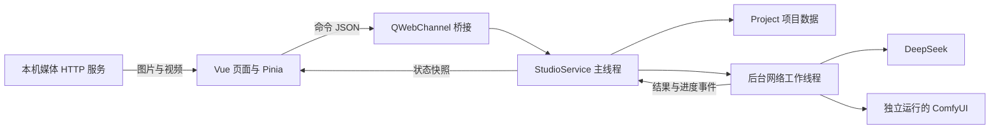
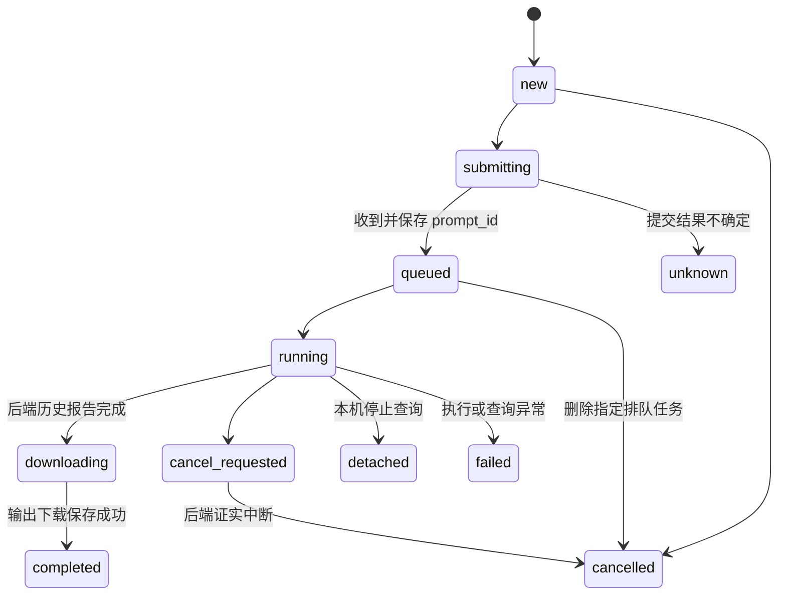
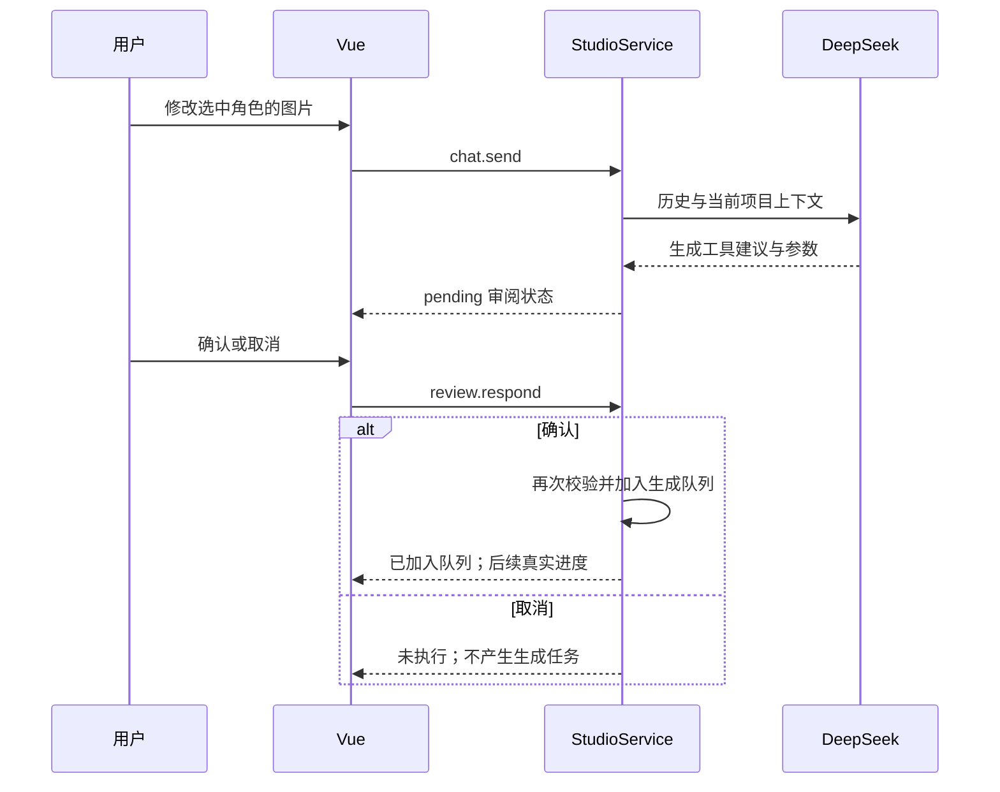

# XY Studio 开发文档：用 Java 理解 Python 后端

本文面向熟悉 Java、暂时不熟悉 Python 的开发者。先说明软件如何运行，再把关键 Python 代码翻译成 Java 风格的示例，最后说明如何定位和修改功能。

实际交付的软件仍是 Vue 3 + Python。下面的 Java 片段是帮助理解的局部对照，不是一套已经完成迁移、可以直接替代后端的 Java 工程。示例中的 Repository、事件分发器等接口用于表达职责；Python 源码才是运行行为的依据。

文内相对源码链接以源代码仓库的 `docs/` 目录为基准。发行包附带本文便于阅读；查看这些源码链接时，请打开原私密仓库中的文档。

## 1. 先认识整个工程

XY Studio 是 Windows 桌面应用。Vue 负责画界面，Python 负责项目、队列、AI 和 ComfyUI。正式入口是 `main.py`，它调用 `studio.desktop.main()`。



这里的 QWebEngineView 可以理解为桌面窗口中的浏览器容器。它显示 Vue 页面，原来的 Qt Widgets 业务界面已经不再是正式入口。QWebChannel 负责业务通信。本机 HTTP 服务只提供 Vue 静态文件和项目媒体，不承担业务 API，也不是一个独立 Python 服务进程。

从 Java 的习惯理解，可以把几个部分对应成：

| 当前实现 | Java 开发中的相近职责 | 源码 |
|---|---|---|
| `Desktop` | 桌面启动器、窗口和生命周期管理 | [desktop.py](../studio/desktop.py) |
| `Bridge` | 请求适配器、统一响应包装 | [desktop.py](../studio/desktop.py) |
| `StudioService` | Application Service / Controller | [service.py](../studio/service.py) |
| `Project` | 项目聚合对象与文件 Repository | [storage.py](../studio/storage.py) |
| `Generation` | 生成参数 DTO，附校验方法 | [workflows.py](../studio/workflows.py) |
| `Comfy`、`execute` | 外部系统 Client、任务执行器 | [comfy.py](../studio/comfy.py) |
| `chat` | 有调用上限的 AI 建议服务 | [deepseek.py](../studio/deepseek.py) |
| `display_chat_text` | 只影响展示的转换器 | [presentation.py](../studio/presentation.py) |
| Pinia Store | 前端状态容器 | [studio.ts](../frontend/src/stores/studio.ts) |
| Gateway | 请求 Promise 与事件桥接 | [gateway.ts](../frontend/src/gateway.ts) |

没有 Spring 容器、数据库 ORM 或 Java 后端；这些对应只是方便理解职责。

## 2. 阅读 Python 所需的最少语法

| Python 写法 | Java 中如何理解 |
|---|---|
| `class Project:` | `class Project { ... }`；缩进界定代码块 |
| `def save(self):` | 实例方法 `void save()`；`self` 相当于 `this` |
| `def __init__(self, root):` | 构造函数 `Project(Path root)` |
| `self.root = root` | `this.root = root` |
| `dict` / `{'id': value}` | `Map<String, Object>`；当前工程大量使用 JSON 形状的字典 |
| `list` / `[a, b]` | `List<T>` |
| `None` | `null` |
| `value.get('id')` | `map.get("id")`；可传第二个参数作为缺省值 |
| `value['id']` | 必须存在的键；缺失会抛异常，而不是返回 `null` |
| `@dataclass` | 自动补构造函数等的 DTO；不像 Java `record` 那样自动成为不可变对象 |
| `@Slot(str, object)`、`Signal(...)` | Qt 的事件接收方法与事件声明；不是 Spring 注解 |
| `lambda: fn()` | `() -> fn()` |
| `copy.deepcopy(x)` | 对嵌套集合做深复制；`new ArrayList<>(x)` 只有浅复制，不能直接替代 |
| `try ... except ... finally` | `try ... catch ... finally` |
| `raise ValueError(...)` | `throw new IllegalArgumentException(...)` |
| `with file.open(...) as f:` | `try (var f = ...)` 自动关闭资源 |
| `asdict(g)` | 将参数对象转成字典；相近于 DTO 转 Map，不等于序列化成 JSON 字符串 |

列表推导式例如 `[j for j in jobs if j['target'] == id]`，相近于 Java Stream 的 `filter(...).toList()`。`next(generator, None)` 是取第一个匹配项，找不到返回 `None`，相近于 `findFirst().orElse(null)`。

特别留意 `x or default`：Python 会把空字符串、空列表、0、`None` 等都当作假值；不能机械翻成 Java 的空值判断。

## 3. 项目数据：稳定 ID 比列表位置更重要

一个项目是一个文件夹，主要内容如下：

```text
我的项目/
  project.json               项目、条目、对话和任务索引
  assets/                    导入的参考素材
  outputs/<job-id>/          每项任务下载保存的输出
  jobs/<job-id>.json         单项任务日志，用于恢复
  jobs/<job-id>-graph.json   实际提交的生成图
```

视频预览还可能产生派生缓存，实际路径由 `video_preview.py` 管理。输出原文件保留，不能把预览转码文件当成用户原始资产。

`project.json` 的 `schema` 当前为 1，包含 `characters`、`scenes`、`shots`、`jobs`、`chat` 等字段。角色、场景、分镜都具备 `id`、`name`、`description`、`image`、`video`、`materials` 和 `versions`。不要把前端 DTO 的字段直接写回项目 JSON。

用 Java 表达概念：

```java
// 概念模型：省略 JSON 映射、时间和可选字段。
class Item {
    String id;                 // 永久身份，不随排列或改名变化
    String name;
    String description;
    String image;              // 当前图片的项目相对路径
    String video;
    List<String> materials;    // 分镜关联的角色/场景 ID
    List<Version> versions;
}

record Version(String id, String jobId, String kind,
               String file, String prompt) {}

class Job {
    String id;                 // 这次生成的身份
    String targetId;           // 新任务固定为 __library__；旧任务保留原 Item ID
    boolean libraryOnly;       // 恢复旧未完成任务时，保留 targetId 但输出仅入库
    String name;               // 库中生成结果的显示名称
    Generation generation;
    String status;
    String promptId;           // ComfyUI 任务身份，与上面的 ID 不同
    List<String> outputs;
}
```

`uid()` 使用 `uuid.uuid4().hex`，生成不带连字符的字符串。Java 类似 `UUID.randomUUID().toString().replace("-", "")`。

分镜编号只是显示顺序。删除镜头后“分镜 3”可以变成“分镜 2”，但真实 ID 保持不变。自定义镜头名称保存于 `original_name`，不用它来建立引用。

### 3.1 生成与选用是两个独立操作（v1.2.0）

新任务的 `job.target` 固定为 `__library__`。执行器只下载输出并记录 `job.outputs`；`Project.attach_output` 对新任务直接返回，不改变任何角色、场景或分镜。`AssetLibrary` 从任务、旧版本和原文件建立统一索引，因此未选用结果也能查询。

用户确认选用时才调用 `asset.from_media` 或 `asset.use_media`。新建角色/场景继承库中素材名称，或使用用户填写的名称；选用不会复制原文件，也不改素材库身份。Java 对照：

```java
static final String LIBRARY_TARGET = "__library__";

// 生成完成：job.outputs 已由执行器登记。
void onCompleted(Job job) {
    if (!job.libraryOnly && !LIBRARY_TARGET.equals(job.targetId)) {
        attachLegacyOutput(job); // 只兼容旧任务原归属，不读取当前 UI 选择
    }
    saveProject();
    publishState();
}

// 用户明确选用：角色/场景只接收图片，分镜可接收图片或视频。
String useMedia(String itemId, LibraryMedia media) {
    Item item = findById(itemId);
    validateOriginalExists(media.file());
    validateMediaKind(item, media.kind());
    Version version = item.versions.stream()
        .filter(v -> v.file().equals(media.file()) && v.kind().equals(media.kind()))
        .findFirst().orElse(null);
    if (version == null) {
        version = versionFromOriginal(media); // 保留原生成任务关联
        item.versions.add(version);
    }
    if (media.kind().equals("video")) item.video = media.file();
    else item.image = media.file();
    markDependentShotsForReview(item.id);
    saveProject();
    return version.id();
}
```

这里的 `LibraryMedia`、辅助方法是职责示例，不是已编译的 Java 后端。实际接口校验在 `StudioService.dispatch()`，登记在 `Project.use_media()`。再次选择同一文件复用原版本，不重复登记。

旧 `job.target`、条目 ID 和已有版本不改写。打开旧项目时重放旧完成日志仍保持旧归属；恢复旧未完成任务时增加可选 `library_only=true`，保留原目标用于追溯，但后续新输出也只入库。打开新项目不会把未选用结果自动放入卡片。历史页始终从 `job.outputs` 找本次结果，不能拿卡片当前图片替代。

### 3.2 保存、路径和删除

`atomic_json` 先写同目录临时文件，刷新并同步文件，再用 `os.replace` 替换目标。Windows 短暂占用导致替换失败时有限重试。不要直接截断旧文件后写入，否则崩溃可能损坏唯一项目文件。

Java 中相近的做法是临时文件、`FileChannel.force(true)` 和替换移动；不同文件系统对原子移动支持不同，正式移植必须处理其行为和重试，不能只复制几行示例就声称兼容。

`Project.file(relative)` 会解析真实路径并检查仍在项目根目录内。Java 类似 `root.resolve(relative).toRealPath()` 后检查 `startsWith(root)`，但不存在的输出、符号链接和 Windows junction 需要单独处理。

桌面打开项目时使用 `QLockFile`，阻止两个实例同时修改同一项目。删除条目会解除分镜引用并标记待检查；已有文件和任务历史保留供恢复。桌面服务还禁止删除有未完成任务的条目。

## 4. Vue 到 Python：请求与状态是两条通路

业务通信不是 `fetch('/api/...')`。前端 Gateway 调用桥接对象 `studio.request`：

```json
{
  "id": "request-unique-id",
  "command": "generation.submit",
  "payload": {
    "generation": { "mode": "krea", "prompt": "..." }
  }
}
```

上面只展示通信形状，省略了实际完整生成参数；不是可直接提交的测试请求。

Bridge 解析、验证外层结构，交给 `StudioService.dispatch()`。成功返回 `{id, ok:true, result}`，异常返回 `{id, ok:false, error}`。前端等待 Map 用请求 ID 找到 Promise，决定 resolve 或 reject。

Java 概念对照：

```java
record Request(String id, String command, Map<String, Object> payload) {}
record Reply(String id, boolean ok, Object result, String error) {}

Reply handle(Request request) {
    try {
        Object result = service.dispatch(request.command(), request.payload());
        return new Reply(request.id(), true, result, null);
    } catch (Exception e) {
        return new Reply(request.id(), false, null, e.getMessage());
    }
}
```

生成请求返回的是任务 ID，**不是最终图片**。后续进度和结果通过 `stateChanged` 推送整个状态快照，Pinia 更新响应式页面。`notification` 单独传递错误或提醒。

以下是现有主要命令，参数完整校验以 `service.py` 为准：

| 命令 | 关键参数 | 作用 |
|---|---|---|
| `bootstrap` | 无 | 读取项目、设置、任务、审阅等当前状态 |
| `project.new / open` | `path` 可选；新建可带 `title` | 无路径时打开桌面文件选择器 |
| `project.save / story / folder` | 故事带 `text` | 保存项目、修改故事、打开项目目录 |
| `selection` | `id`、`toggle`、`pin`、`clear` 可选 | 选择或取消、固定 AI 上下文、清空上下文 |
| `asset.add` | `kind`、`name`、`description` | 自动编号分镜；旧接口兼容 |
| `asset.from_media` | `kind`、`file`、可选 `name` | 用户从图片库添加角色/场景 |
| `asset.use_media / rename` | `id`、`file` / `id`、`name` | 选用库中原文件 / 修改资产名称 |
| `asset.update / delete / reviewed` | `id`；更新还带名称和描述 | 修改、删除、清除待检查标记 |
| `asset.link` | `id`、`ids` | 分镜关联已有角色和场景 |
| `asset.import` | `id`、`paths` 可选 | 导入图片并登记版本 |
| `references.import` | `paths` 可选 | 导入生成用参考图，保留顺序 |
| `version.use` | `id`、`version` | 切换当前图片或视频，旧历史不变 |
| `generation.defaults / preview` | 可选模式、媒体类型 / 完整参数 | 恢复最近配置 / 计算尺寸和实际帧数，不排队 |
| `generation.submit` | `generation`、可选 `name` | 校验、保存素材库任务并进入队列 |
| `references.describe` | 有序 `files` | 返回原参考图名称、预览 URL、缺失状态 |
| `queue.toggle` | 无 | 暂停或继续后续任务 |
| `task.cancel / resume` | `id` | 取消指定任务 / 查询已知后端任务 |
| `chat.send` | `text` | 真实 DeepSeek 请求 |
| `review.respond` | `id`、`accepted`、`generation` 可选 | 对指定建议确认或取消 |
| `settings.save / models.refresh` | 设置对象 / 无 | 保存设置与密钥 / 获取账户模型列表 |
| `agent.import` | `path` 可选 | 导入建议文件，仍经过审阅，不是实时 Codex 接入 |
| `media.open / link.open` | 项目相对 `file` / `url` | 打开原文件 / 安全协议的外部链接 |
| `error.clear / app.close` | 无 | 清理已读错误 / 正常退出 |

`snapshot()` 是展示 DTO：例如种子转成字符串，视频加预览 URL，任务加 `results`，对话转成可读文本。新增 DTO 字段不等于修改 `schema=1`。

## 5. 生成参数和工作流

`Generation` 相近于一个有默认值的 Java 参数类：

```java
class Generation {
    String mode = "qwen";
    String prompt = "";
    String ratio = "16:9";
    double megapixels = 1.0;
    double seconds = 5.0;
    long seed = 42;
    int steps = 0;             // 0 表示采用对应工作流的默认采样步数
    boolean cinema = false;
    double cinemaStrength = 0.4;
    boolean quadLora = true;
    List<String> styles = new ArrayList<>();
    double scale = 2.0;
    List<String> references = new ArrayList<>();
    boolean qwenInt8 = false;
}
```

这些是领域对象的缺省值。GUI 读 `generation.defaults` 时还会按图片/视频任务设置合适的初始值并回填上次提示词，因此不要把它们误解成每个窗口始终显示的值。

v1.1.1 的新请求在 `StudioService.defaults()` 调用 `new_seed()`，相当于 Java 的 `new SecureRandom().nextLong() & Long.MAX_VALUE`，以字符串返回给 Vue；不会继续默认固定为 42。用户确认后保存该值，恢复任务、使用历史参数时不会重新随机。领域对象保留 `seed=42` 作为旧参数缺失时的兼容缺省值。`default_steps(mode)` 统一提供 Qwen 40、四视图 10、RFMSR 15、其他工作流 8；默认窗口显示具体数值，输入 0 在提交前解析为实际步数并写入记录。

当前模式包含 Qwen 文生图/编辑、Krea2 文生图/四视图、H3 图生/参考/文生/首尾帧视频，以及 RFMSR 放大。新图片和视频任务都独立生成到素材库，无需先有分镜。用户选用时，角色/场景只接收图片，分镜可接收图片和视频。

`references` 是有序列表，提示词的 `<image1>` 等引用必须对应真实顺序。Qwen 编辑最多 16 张，H3 参考 1–9 张，首尾帧恰好 2 张，放大使用 1 张。不能把尚未生成的未来路径当参考。

### 5.1 比例、尺寸和时间

`resolution()` 将比例和像素预算换成宽高。H3 与 Qwen 编辑自定义画布按 32 对齐；Krea 按 8 对齐。v1.1.0 的 Qwen T2I 按批准工作流使用 8 像素选择器，实际空 latent 经 16 像素 VAE 再对齐；界面预计输出按这一步计算。编辑默认使用原始第一张参考图，经编码器按 32 对齐，不再预先居中裁剪。放大预览按输入尺寸乘倍数计算。

`frames()` 使用 24 fps，把帧数对齐到 `5 + 17k`。Java 算法对照：

```java
int frames(double seconds) {
    if (!Double.isFinite(seconds) || seconds < 0.2 || seconds > 149)
        throw new IllegalArgumentException("时长超出范围");
    // Python round 的半数取偶规则用 Math.rint 表达，避免机械使用 Math.round。
    int n = Math.max(5, (int) Math.rint(seconds * 24));
    return n + Math.floorMod(5 - n % 17, 17);
}
```

例如输入 0.5 秒，12 帧向合法长度对齐为 22 帧，实际约 0.917 秒。参数窗口应显示实际结果；提示词时间线也要匹配实际时长。范围校验通过只代表参数合法，不能证明本机显存足够。

种子允许 0 到 `2^63-1`。Java `long` 能精确表示；JavaScript `number` 无法精确表示所有这些整数，因此桥接层以十进制字符串传种子，Python 验证并转回整数。

### 5.2 LoRA 的开关必须改变实际图

`build()` 构造 ComfyUI API 图：节点 ID 对应 `class_type` 和 `inputs`。电影 LoRA、四视图 LoRA、风格 LoRA 关闭时，相应加载节点不出现在图里。仅隐藏前端勾选状态无法真正停用。

`preflight()` 用本机 `object_info` 检查节点、必填输入和模型枚举，遇到缺模型或节点直接报错。没有自动下载安装模型的逻辑。独立的电影感工作流仍按原范围排除；H3 内电影 LoRA 开关保留。

## 6. 队列、后台线程和数字进度

提交任务时，服务复制完整生成参数，把素材库任务保存为 `new`，再调用 `start_next()`。原提示词、有序参考图和全部参数保存在任务中；`defaults()` 从最近同模式任务恢复，只有新请求种子换新。历史“再次生成”使用所选历史任务的完整原配置。取消生成窗口不会覆盖上次已提交配置。

同一 Studio 实例只执行一个生成/恢复任务。`start_next()` 在没有 active 任务且队列未暂停时，取第一项 `new` 任务。不能把外部 ComfyUI 的整条队列当成自己的队列。



图展示常见路径，不是穷尽所有异常。真实运行中 HTTP 轮询和 WebSocket 事件可能交错，不能只依赖图中的单向顺序。

Java 中可以理解为：用一个拥有数据修改权的线程维护 `Project`，用 `ExecutorService` 执行耗时网络操作，工作线程把事件送回拥有者。当前实现用 Qt 主线程和 Signal/Slot 完成这个分工。

```java
// ownerDispatcher 表示回到数据拥有者线程；Qt 对应跨线程 Signal/Slot。
void startJob(Job source) {
    Job snapshot = deepCopy(source);
    workerExecutor.submit(() -> {
        try {
            ExecutionResult result = execute(snapshot, event ->
                ownerDispatcher.execute(() -> onProgress(event)));
            ownerDispatcher.execute(() -> onCompleted(result));
        } catch (Exception e) {
            ownerDispatcher.execute(() -> onFailed(e));
        }
    });
}
```

后台线程会写该任务日志、下载文件；项目主对象的修改、结果登记和 Vue 状态发布回到 Qt 拥有者线程。不是所有文件 IO 都必须在主线程。

### 6.1 进度从哪里来

1. `Comfy.open_progress()` 建立带 client ID 的 WebSocket。
2. `progress_events(prompt_id)` 只接收属于当前后端任务的事件，支持 `progress`、`executing` 和当前运行节点的 `progress_state`。
3. `execute()` 写入 `progress={value,max}` 并通知服务。
4. `snapshot()` 计算 `value / max * 100`。
5. `TaskProgress.vue` 同时显示百分比、步数和阶段，卡片与全局任务共用实际状态。

Java 对照为 `Double percent = max > 0 ? value * 100.0 / max : null`。准备、解码、保存等无测量值的阶段用 `null`，不能定时加百分比。

当前步骤达到 100% 并不代表整个任务完成。下一步骤可能重新计数，最终完成必须以后端历史、实际下载文件和版本登记为依据。ComfyUI 事件不推送时，可以继续 HTTP 查询结果，但没有依据制造数字进度。本次重启恢复了事件推送，未确认底层阻塞的具体成因。

### 6.2 取消与恢复

排队取消调用 `/queue` 删除指定 prompt ID；运行取消调用本机支持的 `/interrupt` 并带指定 ID，不能无条件中断其他人的任务。

网络提交后如果不知道是否成功，不自动重交。恢复使用任务日志中已保存的 `prompt_id` 查询，不生成第二项相同任务。没有后端 ID 的任务提示人工核对。打开旧项目也不会立即提交其中所有待办任务。

应用退出会保存、释放锁、停止本机查询与自己的预览资源。独立运行的 ComfyUI 保留，任务可能仍在其队列中；下次通过恢复查询核对。因此“退出不遗留本应用进程”和“杀掉所有生成任务”不是同一种实现。

## 7. AI：先建议，再审阅，最后执行

AI 服务有两层循环，必须分清：

| 层次 | 负责模块 | 实际行为 |
|---|---|---|
| 模型请求循环 | `deepseek.chat()` | 单次调用最多 8 轮主模型请求；按需读指南、最多 3 次检索、有限格式修正 |
| 用户审阅与续办 | `StudioService` | 项目写操作逐项确认；成功创建/修改后可继续原请求，最多 4 轮；生成提交后不等待结果自动继续 |

`read_skill`、`web_search` 是读取资料的工具；`add_item`、`update_item`、`set_story`、`generate` 是需要审阅的项目操作。只让 AI 产生建议，不允许它任意执行 Python 代码、访问任意文件或自行提交未审阅的改动。



### 7.1 AI 生成不创建存放条目

新 `generate` 工具只接收模式、提示词和有序参考图，不要求 `target`。说“让这张图动起来”直接提出 `h3_i2v` 审阅，用本轮引用的真实原图，不创建分镜、不补生图。AI 当前没有像素输入，只依据用户说明、选中素材和本轮附件路径编写提示词。

仅用户明确要求把已有图片添加为角色/场景时，`add_item` 才使用库中真实 `file`；不能先创建空资产。审阅仍须有效 pending ID，取消或过期确认不排队。旧导入建议中的 `target` 可读取，但不再决定新结果归属。旧同轮 `@名称` 依赖仍验证已创建成功，取消创建不会执行其依赖操作。

### 7.2 Skill 与补读指南

内置指南在 `studio/skills/`。起始只给模型目录摘要，用到图片编辑或视频时才读取白名单文件，不能提供任意路径读取。

如果模型已提出生成，却漏读必要指南，应用会补读并要求继续通过生成工具提出建议。该修正请求使用 `tool_choice='required'`，普通聊天不强制工具。没有这一步时，模型可能只返回提示词文字，界面拿不到可审阅的生成操作。

H3 提示词需要相应分段顺序，格式校验失败时允许有限修正，仍失败则停止并说明原因。它验证结构，不证明动作或画面效果合格。

### 7.3 本版本为何不自动完成“舞台 → 合成 → 视频”

生成是异步任务，第一次请求时后两步的真实输入文件还不存在。当前 Agent 在提交生成后不会等结果再启动新的对话轮次，因而不具备完整的依赖计划执行器。

要实现连续制作，需要计划状态、输出绑定、失败处理、恢复及各步骤审阅等额外设计。用户已决定本版不做；不能通过预先编造路径、轮询假完成或默默扩大执行权限实现。

### 7.4 用户看到的文本与原始记录

`presentation.py` 只转换用户界面的显示文本：明确的内部 Skill JSON 转成“已参考视频创作指南”；空白或英文工具说明显示中文操作摘要；普通创作文本和用户原文保留。`ChatSources.vue` 保留真实检索来源和获取失败提示。

原始模型消息、工具参数和活动记录仍保存在项目，后续模型上下文使用原始内容。相当于 Java 中 `ChatMessage` 与 `ChatMessageView` 分离。**不能先改坏原始消息，再把修改后的展示摘要传回模型。**

AI 当前拿到文字和文件路径，没有图像像素输入。它可以按照用户要求编写给图像模型的参考编辑指令，不能声称自己已经看过或核验了图片。

## 8. 预览、设置和生命周期

图片 URL 带当前项目的随机媒体 token，媒体服务只允许限定文件类型和项目内路径，支持视频 Range 请求。切换项目后媒体 token 更新；前端使用服务提供的 URL，不拼接硬盘绝对路径。

H3 原视频保留。`PreviewCache` 为 WebEngine 不支持的编码准备兼容预览，`video_poster()` 提取封面，预览失败明确显示错误，不删除原媒体。

设置继续使用 `QSettings('XiYi', 'AIStoryStudio')`；API Key 存于 Windows 凭据管理器的 `AIStoryStudio/deepseek`。更名 XY Studio 没有随意改变这两个兼容标识。前端状态只得到 `keySet`，不会获得密钥字符串。

正式 Windows 包由 PyInstaller 制作，Vue 的 `dist`、内置指南和图标一起打包。必须保留整个 XY-Studio 文件夹。调试端口仅显式 QA 参数启用，正常启动不打开调试端口。

## 9. 按功能定位修改位置

| 想修改什么 | 先看哪些文件 | 必须检查的影响 |
|---|---|---|
| 卡片排列、选中和图片放大 | `AssetCard.vue`、`ShotCard.vue`、`App.vue`、Store | 不能改变素材 ID；双击与单击选择不冲突 |
| 新增或调整生成参数 | `GenerationForm.vue`、`types.ts`、`workflows.py`、Service | 前后端一致校验、旧任务默认值、实际图是否变化 |
| 队列或取消恢复 | `service.py`、`comfy.py` | 不重复提交、不误中断外部任务、日志持久化 |
| 历史结果显示 | Service `snapshot()`、`App.vue`、`GenerationDetails.vue` | 从 job 输出找结果，不能用当前版本替代历史 |
| AI 工具或权限 | `deepseek.py`、`action_targets.py`、Service review | schema 校验、逐项确认、取消后不执行 |
| 用户可读文案 | `presentation.py`、`AssistantPanel.vue`、`ChatSources.vue` | 原始记录不变、创作内容和真实错误不被误删 |
| 新媒体类型 | `media.py`、`media_server.py`、`video_preview.py` | 路径边界、封面、编码兼容、原文件保留 |
| 项目格式 | `storage.py`、Service `load()` | schema 兼容和旧项目测试；优先不改格式 |

## 10. 本机开发与验证

在仓库目录运行，PowerShell 命令如下：

```powershell
.venv\Scripts\python.exe -m pip install -r requirements.txt
npm --prefix frontend ci
npm --prefix frontend run build
.venv\Scripts\python.exe main.py
```

只有 Vue 的浏览器开发页没有正式桌面桥接，会明确报通信错误，不回退成 Mock。需要联调时构建 Vue，再运行桌面源码。

Python 回归：

```powershell
.venv\Scripts\python.exe -m pytest tests --basetemp local-data\pytest-learning -q
```

`--basetemp` 必须使用专用测试目录：pytest 会清理该目录，不能指向用户项目或仓库根目录。

桌面回归通过 Playwright 连接实际 WebEngine。源码 QA 启动示例：

```powershell
.venv\Scripts\python.exe main.py --debug-port 9225
```

在桌面新建专用空项目，测试还需要旧项目验收副本和已完成的真实生成报告。`desktop.spec.ts` 顶部及最后一项测试明确列出了这些前置条件，不能在用户项目上随意跑。正式版的实际命令、项目副本和结果见 [验收记录](VALIDATION-v1.0.0.json)。

`progress-live.mjs` 会真正提交 ComfyUI 任务，`readable-agent.mjs` 会调用 DeepSeek；二者不属于默认 `npm test`。前者使用低规格生成并核对测量值，后者提出真实图片编辑建议后取消，验证不会排队。测试机器须有对应模型、节点和凭据。

打包使用 `scripts/build.ps1`。脚本拒绝覆盖已有版本目录。正式冻结包在 `releases/v1.0.0/`，后续修复使用新版本、新目录、新标签，保留 v1.0.0。

## 11. 建议阅读顺序

先读 `storage.py` 的 `Project.add/get/attach_output`，理解条目和版本；再读 `service.py` 的 `dispatch/submit/start_next/_completed`，理解请求与队列；然后看 `comfy.py` 的 `execute`，理解真实生成和恢复。

接着读 `deepseek.py` 的 `TOOLS/chat` 和 Service 的 `_next_review/review`，理解 AI 为什么只能建议而不能直接越过审阅。最后对照 `gateway.ts`、Pinia Store 和 `TaskProgress.vue`，把整个“点击 → 后端 → 状态 → 页面”流程连起来。

学习时可在专用项目中创建两个角色，为第一个排队后切换选中第二个，观察结果仍归属第一个；再切换当前版本，观察历史页仍显示各次原图。这个例子同时解释了 ID、异步任务、版本和展示 DTO 的关系。

## 12. v1.1.0：素材查询与可取消引用

`AssetLibrary` 是项目文件的只读查询层。它合并条目的 `versions`、当前图片/视频、任务 `outputs`，并扫描项目内 `assets/outputs` 原文件。按相对路径去重，所以同一文件既是当前版本又在历史记录中，只列一次；`previews` 缓存排除。索引 ID 是相对路径的哈希，仅用于界面，不保存成新的角色/场景 ID。

Java 中可理解为先用 `Map<String, MediaRecord>` 按路径聚合，再查询、过滤、排序和分页。下面是概念片段，并非可运行的 Java 迁移实现：

```java
record LibraryQuery(String kind, String query, String source,
                    String owner, int offset, int limit) {}
record LibraryPage(long total, List<MediaRecord> items, boolean hasMore) {}

LibraryPage query(LibraryQuery q) {
    validate(q); // 检查枚举、分页、类型
    List<MediaRecord> matches = inventory().stream()
        .filter(r -> matchesQuery(r, q))
        .sorted(selectedComparator(q))
        .toList();
    var items = matches.stream().skip(q.offset()).limit(q.limit()).toList();
    return new LibraryPage(matches.size(), items,
                           q.offset() + q.limit() < matches.size());
}
```

真实 Python 文件在 `studio/asset_library.py`。只对当前页读取 Pillow/PyAV 元数据，按路径、文件大小、修改时间缓存探测结果；文件变化会重新读取。GUI 的 `library.query` 额外补可播放封面 URL，Agent 查询只拿元数据，不把 URL 或像素当成视觉理解。

`selected`、`context_ids`、`media_context` 分别表示当前讨论对象、固定对象引用、具体文件引用。移除对象时同时取消相同选中对象，防止下一轮又因 `selected` 自动加入；移除文件只影响那个文件。Java 等价操作是 `Set.remove(id)` 和 `attachments.removeIf(a -> a.file().equals(file))`。这不删除素材，也不撤回已发送的 HTTP 请求。

聊天启动时深复制当前项目和引用，再把 `AssetLibrary.query` 作为回调传给 `chat()`。Java 可类比传入一个 `Function<LibraryQuery, LibraryPage>`，工作线程使用稳定快照，不直接访问 UI 线程的可变 `Project`。只读工具在当前轮临时上下文中使用，写操作仍由原 Service 审阅；工具数量上限防止无界循环。

Qwen T2I 默认与新批准文件一致：BF16、40 步、16-bit PNG、6.6 MP 可调；已有图片默认进入编辑。编辑尺寸选择是 `Generation.edit_follow_source`，但保存时从 `job.generation` 中移出，另写到任务顶层，执行器再读取。这样冻结 v1.0.0 的 `Generation(**job['generation'])` 不会遇到未知参数。原 schema、项目 ID 和原图保持不变；新旧 DTO 的展示字段与持久化字段需要分别考虑。

本版额外真实验证脚本为 `qwen-live.mjs` 与 `asset-query-live.mjs`，分别调用真实 ComfyUI 和 DeepSeek，不属于默认离线测试。素材库测试需要专用项目副本和真实旧结果；最新记录见 [v1.1.0 验收](VALIDATION-v1.1.0.json)。


## 13. v1.2.0：素材库优先交互的 Java 对照（历史版本）

本章记录 v1.2.0。其中 13.3 的拖拽已按用户要求在 v1.2.1 删除，当前实现见第 14 章，不再存在 `file_drop.py` 和 `mediaDrag.ts`。

### 13.1 为什么保留 schema 1

新任务沿用旧任务的 `id/generation/status/outputs` 字段，只把 `target` 设为保留值 `__library__`，新增可选 `name`。兼容入口提供原条目时，新记录的可选 `origin_target` 仅用于回填配置，不代表自动采用。恢复旧未完成任务的可选 `library_only` 控制新输出仅入库，原 `target` 不改写。导入显示名放在可选 `media_names` 字典；没有该字典的旧项目照常查询。旧角色描述只从 UI 移除，原数据保留。

把图片分配为两个角色也只引用同一个原文件；库中 ID 是相对路径的摘要，选用、改资产名称、取消 AI 引用都不改变它。移除资产不删除原文件。库中名称与资产名称各自独立。

```java
record GenerationRequest(String mode, String prompt, List<String> references,
                         long seed, int steps) {}
record AdoptRequest(String itemId, String originalFile) {}

// 两个请求必须独立；创建生成任务不能同时调用 adopt。
String generate(GenerationRequest request) { return queue.submit(request); }
String adopt(AdoptRequest request) { return project.useMedia(request); }
```

### 13.2 原输入与生成结果不能混用

例如 `references=[A,B]` 编辑得到 C，再次生成恢复 A、B 和原提示词，不能自动改为 `[C]`。库详情的“基于此图继续编辑”明确开一个新编辑请求，参考图变成 C，提示词由用户重新填写。“用此图生成视频”同理。生成后只有用户确认选用才更改资产或分镜当前文件。

审阅使用 `ReferenceImages.vue` 查询 `references.describe`，显示实际原图、编号、缺失状态，支持放大和移除。生成输入的顺序不能用查询排序替代。

### 13.3 Windows 外部文件拖拽

浏览器 File API 没有可靠的 Windows 绝对路径，视频转成 base64 也不适合原有桥接请求。因此在 `file_drop.py` 的 Qt 事件过滤器接收本机 `QMimeData.urls()`，仅处理本窗口里的本地文件 URL，按 WebEngine 缩放换算坐标，发送 `xy-files-dropped` 事件给 Vue。

Java 近似职责：桌面 WebView 宿主的 DropTarget 取得本机 Path，再通过页面事件传文件列表和落点。下面是概念代码，具体 JavaFX/Swing 拖拽 API 与本项目 Qt 不同。

```java
void onNativeDrop(List<Path> paths, double viewX, double viewY, double zoom) {
    var detail = Map.of("paths", paths.stream().map(Path::toString).toList(),
                        "x", viewX / zoom, "y", viewY / zoom);
    String json = jsonSerializer.write(detail); // 不能拼接未经转义的文件名
    webView.dispatchEvent("xy-files-dropped", json);
}
```

Vue 根据落点选择图片库、视频库、AI 附件或生成参考区；Python 先验证整批类型和可读取性，再导入原文件并保存。内部拖拽使用包含项目 ID 和原相对路径的专用 MIME，拒绝跨项目引用。拖入 AI 只准备下一条消息附件，不能自动发送或生成；附件可移除。

### 13.4 空状态与实际测试

空图片库/视频库提示先生成或导入，并提供入口；已有库搜索无结果提示清除筛选。顶部生成入口在 AI 收起后仍可见。资产添加必须先选图再确认；取消不产生资产、版本或任务。

后端语义测试在 `test_library_flow.py`，桌面端交互在 `library-flow.spec.ts`。原 `desktop.spec.ts` 继续验证旧项目、视频播放、任务进度、恢复入口、历史、选中取消、2K/4K 和大量镜头。真实 DeepSeek 与 ComfyUI 验证独立于默认离线测试，见本版验收记录；不能把测试导入建议当作真实 API 验证。

## 14. v1.2.1：操作校验与素材回收站

### 14.1 这次错误发生在哪里

实际记录中，用户要求“生成洛天依三视图”，模型却调用 `add_item` 添加角色、场景，而且没有图片文件。v1.2.0 的添加操作已改为从图片库选用，因而查询空路径失败。这不是用户需要先创建角色，也不是 ComfyUI 生成失败：请求还没有进入生成队列。

`deepseek.py` 现在在返回 UI 前检查整批工具参数：添加角色/场景必须有当前库中的有效图片；生成新图片应调用 `generate`。失败时将“全部未执行”和纠正原因分别回复给本批每个 tool_call_id，再要求模型重新提出操作；最多纠正两次。超限明确报错，不执行半批操作。原始聊天不改写，旧导入建议仍有兼容入口，但不能绕过 Service 的有效文件检查。

Java 对照是 Service 前的 DTO 校验与有限重试，不是将任何 `add_item` 强制改成 `generate`：

```java
int corrections = 0;
while (withinReadRoundLimit()) {
    AssistantMessage suggestion = model.complete(messages);
    try {
        validateAllCalls(suggestion.calls());
        validateExistingMedia(suggestion.calls(), librarySnapshot);
    } catch (InvalidAction ex) {
        if (corrections++ >= 2) throw new InvalidAction("无法准备有效操作，项目未修改");
        messages.add(suggestion);
        for (ToolCall call : suggestion.calls()) {
            messages.add(ToolReply.failure(call.id(), "本批均未执行：" + ex.getMessage()));
        }
        continue;
    }
    // 仍需原有 Skill 读取、提示词检查，再交给用户审阅。
    return prepareReview(suggestion);
}
```

### 14.2 删除与恢复为何不用 File.delete

原文件会被任务记录、版本和再次生成引用。当前删除定义为“移入本项目回收站”，不是清理磁盘。`project.json` 新增可选 `media_trash` 字典，键仍为项目相对路径；值保存名称、类型、时间。`schema=1`、资产 ID 和素材 ID 不变。没有该字段的旧项目按空回收站处理。

```java
record TrashEntry(String name, String kind, Instant time) {}

void deleteMedia(String file) {
    requireProjectRelativePath(file);
    requireNoActiveAgentReview();
    MediaRecord media = inventory.find(file);
    requireNotCurrentInCharacterSceneOrShot(file);
    requireNotReferencedByUnfinishedJob(file);
    project.mediaTrash().put(file, new TrashEntry(media.name(), media.kind(), Instant.now()));
    pendingAttachments.removeIf(a -> a.file().equals(file));
    project.saveAtomically();
}

void restoreMedia(String file) {
    requireTrashEntry(file);
    requireOriginalFileExists(file);
    project.mediaTrash().remove(file);
    project.saveAtomically();
}
```

普通图库查询、资产选择与 Agent 查询排除回收站；专用 `library.query(trash=true)` 只返回回收站条目。历史仍可查看，原生成参数仍保留；若再次生成需要已删除的参考图，提示先恢复。切换资产历史版本也不能重新选用回收站图片。恢复保留原路径、素材 ID 和原字节。旧版本不识别新字段，回退旧版会重新显示这些文件；这不会丢失文件，但不能用旧版维护回收站状态。

### 14.3 拖拽取消后保留哪些入口

Vue 移除素材 MIME、落点判断、拖入引用等逻辑，文档捕获阶段阻止 dragstart、dragover、drop 的默认行为。Qt WebEngine 禁用接收 drop，删除本地文件事件过滤器。导入按钮、文件选择框、发送给 AI、引用移除以及上移/下移参考图按钮继续使用原后端接口。

### 14.4 测试对应什么证据

`test_agent.py` 通过可控模型回复验证两次纠正上限、整批不执行、真实已有图片仍能进入选用审阅。`test_library_flow.py` 验证删除恢复持久化、当前素材与未完成任务保护、旧任务恢复不能重新采用已删除输出。桌面测试操作真实 Vue + Qt 桥接及测试目录，检查点击、预览、原字节与历史身份；测试夹具中已有的视频输出不等于本轮重新生成视频。

`agent-three-view-live.mjs` 是显式运行的真实 DeepSeek 回归：对原用户项目副本保留旧聊天，发送相同文字；打包版继续以 0.2 MP、实际 40 步完成 Qwen 生图，再从 UI 删除和恢复结果。源码验证只到参数审阅并取消。两个层次分开记录，详见 [v1.2.1 验收](VALIDATION-v1.2.1.json)。
